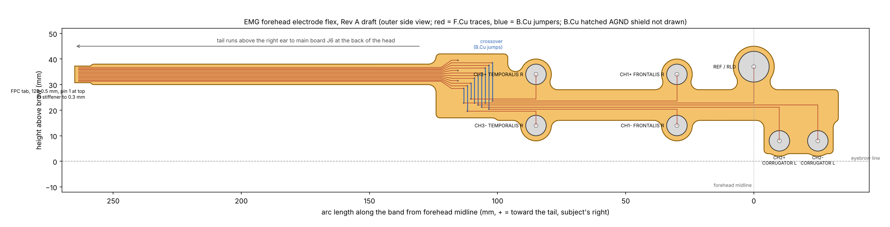

# Forehead EMG electrode flex, Rev A draft

A single 2-layer polyimide flex that carries seven skin electrodes across the
forehead and temple and runs back above the right ear to the main board's FPC
connector (J6, Hirose FH34SRJ-12S-0.5SH) at the back of the head.

Status: draft for discussion. DRC is clean in KiCad 7 (0 violations, 0
unconnected, zones filled); the board has not been fitted on a head yet.

## Files

- `gen_flex.py`: generates everything. Electrode positions, tail length, lane
  order and pitches are constants at the top; edit and re-run
  (`pip install shapely matplotlib`).
- `kicad/emg_flex_electrodes.kicad_pcb`: the board (KiCad 7 format, opens in
  KiCad 9/10). Zones are saved unfilled: press **B** after opening.
- `kicad/emg_flex_electrodes.kicad_dru`: lets the FPC contacts sit 0.2 mm from
  the tab edge.
- `docs/flex_layout.png`: drawing of the outline, electrodes and routing.

There is no schematic: nets are assigned on the board. It is 8 nets and 13
pads, so the board is the source of truth for now.

## Electrode sites

Coordinates are arc length along the band from the forehead midline (+ toward
the tail, which runs along the subject's right) and height above the eyebrow
line. The tail side is `TAIL_SIDE` in `gen_flex.py`; it follows the main
board's connector (see below).

| Electrode | Net | Site (x, y) mm | Muscle and gesture | Pair axis |
|---|---|---|---|---|
| E1 / E2 | CH1 +/- | (30, 34) / (30, 14) | Right frontalis, above mid-pupil: brow raise | Vertical, along the fibres, 20 mm |
| E3 / E4 | CH2 +/- | (-10, 8) / (-25, 8) | Left corrugator, just above the inner brow: frown | Horizontal, along the fibres, 15 mm |
| E5 / E6 | CH3 +/- | (85, 34) / (85, 14) | Right anterior temporalis at the temple: jaw clench | Vertical, along the anterior fibres, 20 mm |
| E7 | REF / RLD | (0, 37) | Upper midline forehead, between the frontalis bellies | Ø12 mm for lower contact impedance |

Why these three:

- They give three gestures a player can make independently while playing:
  raise brows, frown, clench. Brow raise is the signal used in the earlier
  experiments (`signal_acquisition/data_2025-02-28_raisebrows.csv`).
- All three sit on skin a headband covers and that is usually free of hair.
  The temporalis site is at the front of the temple; on people with a low
  hairline it may sit on hair and need repositioning.
- Temporalis is how a headband gets "upper jaw" activity. The masseter is
  below the zygomatic arch and out of reach of a band; clench shows up
  strongly on anterior temporalis anyway.
- One side per muscle is enough because these gestures are bilateral. The
  corrugator pair is on the left and frontalis on the right to put distance
  between them. Expect crosstalk anyway: corrugator and the lower frontalis
  overlap at the brow, so firmware should treat CH1/CH2 as a mixed pair.
- REF at the upper midline sits over the thin aponeurosis between the two
  frontalis bellies, the quietest skin on the forehead.

Spacing follows SENIAM: 20 mm between electrode centres, along the fibre
direction. Corrugator is a small muscle, so its pair is at 15 mm. Pads are
Ø8 mm.

## Construction

- 2-layer polyimide, 0.11 mm, ENIG, yellow or black coverlay (JLCPCB flex).
  The outline is 298 × 43 mm, inside JLC's 234 × 490 mm flex limit.
- Skin side is **B**. Electrodes are Ø8 mm (REF Ø12) ENIG pads exposed on B,
  with a 1.5 mm plated hole for a domed contact's shank soldered on the outer
  (F) side.
- Signals run on **F** (outer). **B** carries a hatched AGND shield between
  the traces and the skin, so traces do not pick up the skin they cross and
  the band stays flexible. It is tied to the three AGND pins.
- Along the tail the 12 conductors keep the connector order at 0.5 mm pitch,
  so each P/N pair stays adjacent (small loop area) with an AGND guard between
  channels. A crossover block in front of the ear re-orders them with short
  B.Cu jumps so every electrode can leave the bundle without crossings.
- The three REF pins are joined into one REF net at the crossover.
- Stiffeners (drawn on the `Stiffener` user layer): 0.2 mm PI on the B side
  of the FPC tab, giving about 0.31 mm with the 0.11 mm flex (Hirose asks for
  0.30 ± 0.03 mm). Rings behind each electrode on the F side (0.2 mm FR4 with a
  4 mm hole for the shank) stop the dome from peeling the pad when the band
  flexes.

## Electrodes

The goal is a contact with a slight protrusion (about 1 to 1.5 mm) that
anchors the band without digging in, similar to the domes on a Delsys sensor.
The footprint takes either of:

1. A gold-plated or stainless dome-head stud or rivet, about 6 mm head and
   1.5 mm shank, pressed through the plated hole and soldered on the F side.
   This is the default; the specific part is not chosen yet.
2. A male ECG snap stud, for using stick-on gel electrodes during bench
   validation of the sites.

Dry gold contacts work once the skin is a little moist; expect higher
impedance and more motion artefact in the first minutes. Ag/AgCl gives lower
noise if the dry contacts are not good enough.

## Mating with the main board

The tail carries the main board's J6 pin order (hardware/emg-rev-a-kicad,
commit 57179a6): 1 AGND, 2/3 CH1 P/N, 4 REF, 5 AGND, 6/7 CH2 P/N, 8 REF, 9
AGND, 10/11 CH3 P/N, 12 REF. The tab is 6.5 mm wide with 0.3 × 2.5 mm contacts
at 0.5 mm pitch. The crossover block re-orders lanes, so a later pin order
change on the main board only means editing `PINS` and regenerating.

J6 sits on the main board's F side at its right edge, rotated so the FPC
enters from the right (mounting-tab side) with pin 1 toward the top of the
board. Assuming the main board is worn with F facing out and its USB-C
pointing down, that opening faces the subject's right, so the tail runs along
the right side. Seen from outside, the tail arrives with its outer side (F) up
and pin 1 at the top edge, which lands on J6 pin 1. The FH34SRJ makes contact
on either face of the FPC, so contacts on F work.

Check before ordering:

- **Main board orientation on the head.** If it is worn the other way up or
  with F facing the head, the tail must come from the other side or the pin
  order mirrors: set `TAIL_SIDE` or reverse `PINS` and regenerate.
- **Tail length.** `X_END` puts the connector 265 mm along the band from the
  midline, which assumes a 57 cm head and J6 about 20 mm short of the back
  centre. Measure on the real band and the main board.
- **Elastic bands.** A flex does not stretch. If the band is elastic, fix the
  flex at the forehead and at the connector and leave slack (or a sewn S-loop)
  along the tail.
- **Tab and contacts** against the Hirose FH34SRJ FPC drawing (width G = 6.5
  ± 0.05 mm for 12 positions, thickness 0.30 ± 0.03 mm).

## Open questions

- Fit on a real head: brow-to-hairline height and where the band sits decide
  whether the 20 mm vertical pairs fit, or need to go to 15 mm.
- Whether a second temporalis pair (left side) is worth a channel; the
  ADS1298 has five spare channels but J6 only carries three.
